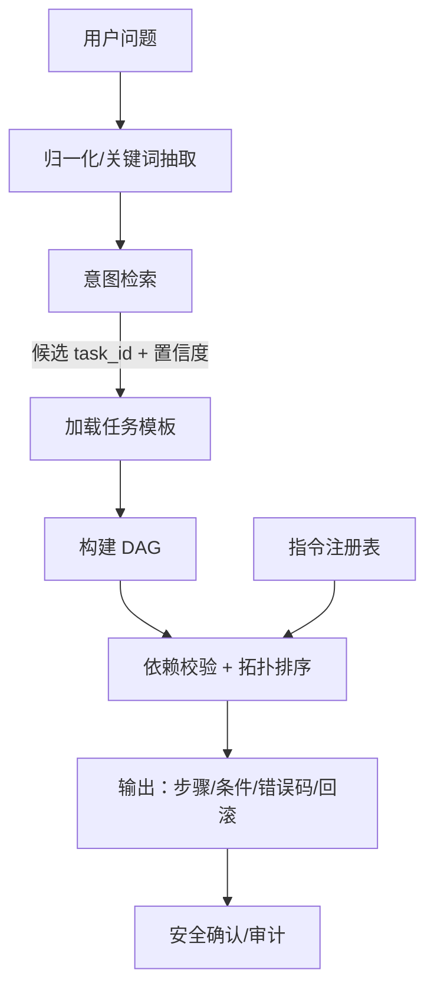

# GM 指令任务编排助手 · 技术设计文档

| 项目 | 内容 |
|---|---|
| 文档版本 | v1.0 |
| 日期 | 2026-10-20 |
| 状态 | 设计稿（待评审） |
| 定位 | 实习产出 / 内部提效工具 |
| 关联资产 | `.codemaker/skills/g66-gm-assistant`、`building-system` 知识库 |

---

## 1. 背景与问题

### 1.1 现状

测试与策划在日常工作中经常需要执行**多组 GM 指令**来完成一个业务动作，例如：

- 合居：`cohabit` → `mergebuilding2`
- 分居：`forcedivorce` → `resetmerge2`
- 蓝图变现：`bpdata` → `bppreview create_copy` → `bppreview enter`
- 主题蓝图解锁：`ztlt all` → 进庄园触发 `force_sync_theme_bps`

这些指令之间存在**隐式耦合**：

- 先后顺序（必须先建关系，才能合并地基）；
- 前置条件（合并必须由 A 方主地基 10017 发起）；
- 副作用（`timexx` 会清掉技能 CD、每日刷新等）；
- 错误码语义（`558` = 目标无效/自己，`3410` = 不是 A 方主地基）；
- 回滚方式（`resetmerge2`、`forcedivorce`）。

docs/v2/material_change_log_check_v2.md
scripts/log_check_v2/
reports/log_check_v2/

- 代码（`DebugComp.py`、`HomeBuildingComp.py` 等）；
- GM 指令文档（`g66-gm-assistant/references/gm_ouput/*.md`）；
- 老员工经验；
- 聊天记录。

### 1.2 痛点

1. **不知道怎么组合**：知道单条指令，但不知道完整流程。
2. **不知道怎么排错**：报错码没有语义映射。
3. **不知道怎么回滚**：操作失败后无法恢复。
4. **重复沟通**：同一个问题反复问人。

### 1.3 已有资产

仓库内已有 `g66-gm-assistant`：

- 3600+ 条 GM 指令；
- `scripts/query.py` + `scripts/index.json`；
- 按指令名 / 模块 / 关键词 / 代码文件建立索引；
- `references/gm_ouput/*.md` 指令原文。

**结论：单条指令查询已经被解决，本项目的增量价值在“任务级编排”。**

---

## 2. 目标与非目标

### 2.1 目标

1. 用户用自然语言描述业务动作，工具返回**可执行的多指令组合**；
2. 输出包含：步骤顺序、参数占位、前置条件、错误码解释、回滚方案；
3. 对高风险指令提供**预览 / 确认 / 审计**；
4. 复用现有指令索引，不重复造轮子；
5. 可评测、可维护、可交接。

### 2.2 非目标

- 不做全量 3600 指令的自动编排；
- 不做通用知识图谱；
- 不做生产环境自动执行；
- 不做自动从代码抽取全部依赖（首期手工 + 半自动）。

---

## 3. 术语

| 术语 | 含义 |
|---|---|
| 指令（Command） | 一条 GM / debug 指令，如 `mergebuilding2` |
| 任务（Task） | 一个业务动作，如“合居”“蓝图变现” |
| 任务模板（Task Template） | 描述任务步骤、依赖、回滚的配置 |
| DAG | 有向无环图，描述步骤依赖 |
| 前置条件（Precondition） | 执行前必须满足的状态 |
| 副作用（Effect） | 执行后产生的状态变化 |
| 安全等级（Safety Level） | read / mutate / destructive |

---

## 4. 总体架构



### 4.1 分层结构

| 层 | 数据结构 | 职责 |
|---|---|---|
| 指令注册表 | `dict[str, CommandMeta]` | 指令元数据、参数、前置、错误码 |
| 任务模板 | YAML/JSON + DAG 邻接表 | 业务步骤与耦合 |
| 意图检索 | embedding 索引 + 倒排索引 | 问题 → task_id |
| 命令名补全 | Trie | 指令名/别名前缀匹配 |
| 运行时 | 拓扑排序 + 校验器 | 生成可执行顺序 |

> 图只负责“依赖”，不负责“理解”和“查找”。

---

## 5. 数据模型

### 5.1 指令注册表（Command Registry）

```python
CommandMeta = {
    "cmd": "mergebuilding2",
    "module": "cohabit",
    "side": "server",              # client / server / both
    "params": [],
    "preconditions": ["in_village", "base_id == 10017"],
    "effects": ["merged_base"],
    "conflicts": ["already_merged"],
    "cooldown": "merge_cd",
    "error_codes": {
        3410: "不是 A 方主地基（BD_SUBURB_SMALL_BASE_A_ONLY）",
        3411: "对方不是 B 方地基（BD_MERGE_BASE_B_ONLY）",
    },
    "safety_level": "mutate",
    "source": "server/script/components/avatar/DebugComp.py:11486",
}
```

字段说明：

| 字段 | 必填 | 说明 |
|---|---|---|
| cmd | 是 | 指令名 |
| module | 是 | 业务模块 |
| side | 否 | 客户端/服务端 |
| params | 否 | 参数列表与类型 |
| preconditions | 否 | 前置条件表达式 |
| effects | 否 | 副作用 |
| conflicts | 否 | 互斥状态 |
| cooldown | 否 | 冷却键 |
| error_codes | 否 | 错误码 → 人话 |
| safety_level | 是 | read / mutate / destructive |
| source | 否 | 代码/文档出处，便于追溯 |

**存储**：首期 YAML，运行时加载为 dict；后续可从 `g66-gm-assistant` 的 `index.json` 半自动生成。

### 5.2 任务模板（Task Template）

```yaml
task_id: cohabit_merge
name: 合居（同居 + 合并地基）
intent:
  - 合居
  - 同居
  - 合并地基
aliases:
  - 双人合租
  - 住一起
preconditions:
  - same_scene
  - both_online
  - single
  - no_divorce_cd
steps:
  - id: s1
    cmd: cohabit
    args: ["<target_id>"]
    requires: [same_scene, both_online, single]
    effects: [cohabit_relation]
  - id: s2
    cmd: mergebuilding2
    requires: [s1.done, in_village, base_id == 10017]
    effects: [merged_base]
edges:
  - [s1, s2, before]
rollback:
  - forcedivorce
  - resetmerge2
error_map:
  558: "目标无效/自己/已在同居"
  3410: "不是 A 方主地基，需 10017 发起"
  3411: "对方不是 B 方地基"
safety_level: mutate
owner: building-system
version: 1
updated_at: 2026-10-20
```

字段说明：

| 字段 | 必填 | 说明 |
|---|---|---|
| task_id | 是 | 唯一标识 |
| name | 是 | 展示名 |
| intent | 是 | 语义触发词 |
| aliases | 否 | 同义说法 |
| preconditions | 否 | 任务级前置 |
| steps | 是 | 步骤列表 |
| edges | 是 | 步骤依赖（before / after / conflict） |
| rollback | 否 | 回滚指令 |
| error_map | 否 | 错误码解释 |
| safety_level | 是 | 安全等级 |
| owner / version / updated_at | 是 | 维护信息 |

### 5.3 意图检索索引

#### 倒排索引（关键词）

```python
INVERTED = {
    "合居": {"cohabit_merge"},
    "同居": {"cohabit_merge"},
    "蓝图变现": {"bp_realize", "bp_realize_local"},
    "主题蓝图": {"theme_bp_unlock"},
}
```

#### 向量索引（语义）

- 每个 `task_id` 生成一条文本：`name + intent + aliases + 摘要`；
- 使用 embedding 模型编码；
- 查询时计算余弦相似度，取 top-k。

#### 融合排序

```python
score = 0.5 * bm25_score + 0.5 * cosine_score
```

低于阈值时返回“未匹配到任务”，而不是硬猜。

### 5.4 命令名 Trie（可选）

仅用于：

- 指令名前缀补全：`merge` → `mergebuilding2` / `mergebuilding3`；
- 别名解析：`合居` → `cohabit`。

不用于业务编排。

---

## 6. 运行时流程

```text
1. 输入归一化
2. 关键词命中 + 向量检索 → 候选 task_id
3. 置信度过滤 / 兜底
4. 加载任务模板
5. 构建 DAG（邻接表 + 入度）
6. 校验前置条件（静态 + 运行时上下文）
7. 拓扑排序，生成执行顺序
8. 渲染输出（步骤/参数/错误码/回滚）
9. 安全确认 / 审计记录
```

### 6.1 拓扑排序

```python
import heapq
from collections import defaultdict

def topo_sort(steps, edges):
    adj = defaultdict(list)
    indeg = {sid: 0 for sid in steps}
    for a, b, _ in edges:
        adj[a].append(b)
        indeg[b] += 1
    heap = [sid for sid, d in indeg.items() if d == 0]
    heapq.heapify(heap)
    order = []
    while heap:
        cur = heapq.heappop(heap)
        order.append(cur)
        for nxt in adj[cur]:
            indeg[nxt] -= 1
            if indeg[nxt] == 0:
                heapq.heappush(heap, nxt)
    if len(order) != len(steps):
        raise ValueError("task template has a cycle")
    return order
```

### 6.2 校验器

```python
def validate(step, context, completed):
    for cond in step.get("requires", []):
        if not eval_condition(cond, context, completed):
            return False, cond
    return True, None
```

条件类型：

| 类型 | 示例 |
|---|---|
| 场景 | `in_village`、`spaceno == 4` |
| 归属 | `base_id == 10017`、`owner_id == player.id` |
| 步骤 | `s1.done` |
| 状态 | `single`、`no_divorce_cd` |
| 参数 | `target_id != self.id` |

---

## 7. 输出格式

建议同时输出**人类可读**与**结构化**两种：

### 7.1 人类可读

```markdown
## 合居（同居 + 合并地基）

前置条件：
- 双方在线、同场景
- 双方单身、无分居冷静期
- 由 A 方主地基（10017）发起合并

步骤：
1. `cohabit <target_id>` —— 发起同居
2. `mergebuilding2` —— 合并地基（必须 A 方执行）

常见错误：
- 558：目标无效 / 自己 / 已在同居
- 3410：不是 A 方主地基

回滚：
- `forcedivorce`
- `resetmerge2`
```

### 7.2 结构化

```json
{
  "task_id": "cohabit_merge",
  "confidence": 0.92,
  "steps": [
    {"order": 1, "cmd": "cohabit", "args": ["<target_id>"]},
    {"order": 2, "cmd": "mergebuilding2", "args": []}
  ],
  "preconditions": ["same_scene", "both_online", "single"],
  "error_map": {"558": "...", "3410": "..."},
  "rollback": ["forcedivorce", "resetmerge2"],
  "safety_level": "mutate"
}
```

---

## 8. 安全与权限

GM 指令具有破坏性（清空地基、删除物品、强制分居），必须做安全设计：

| 等级 | 示例 | 策略 |
|---|---|---|
| read | `printswitch`、`bppreview show` | 可直接展示 |
| mutate | `cohabit`、`mergebuilding2` | 默认只预览，需确认 |
| destructive | `resetbp`、`forcedivorce`、`timexx` | 必须二次确认 + 审计 |

要求：

1. **默认不自动执行**，只输出指令组合；
2. 执行前展示完整命令与参数；
3. 记录审计日志：`task_id`、`cmd`、参数、操作人、时间；
4. 高风险任务提供回滚步骤；
5. 不在生产环境开放自动执行。

---

## 9. 评测方案

### 9.1 数据集

- 50~100 条真实问法（从聊天记录/测试反馈收集）；
- 覆盖 20~30 个高频任务；
- 每条标注：`query`、`expected_task_id`、`expected_params`。

### 9.2 指标

| 指标 | 说明 |
|---|---|
| Intent Accuracy@1 | 意图命中率 |
| Intent Recall@3 | 前三候选命中率 |
| Slot Accuracy | 参数抽取正确率 |
| Order Correctness | 步骤顺序正确率 |
| Human Rating | 人工 1~5 分 |
| Time Saved | 相比查文档的耗时 |

### 9.3 基线

- 基线 1：现有 `g66-gm-assistant` 关键词搜索；
- 基线 2：人工查文档/问人。

---

## 10. MVP 范围与里程碑

### 10.1 MVP 范围

**做：**

- 指令注册表加载器；
- 20~30 个任务模板；
- 关键词 + embedding 意图检索；
- DAG 拓扑排序 + 前置校验；
- 人类可读 + 结构化输出；
- 错误码映射、回滚方案；
- 评测集与报告。

**不做：**

- 全量指令树；
- 图数据库；
- 自动代码抽取；
- 生产自动执行。

### 10.2 里程碑（8 周）

| 周 | 交付 |
|---|---|
| 1~2 | 需求验证、5 个任务模板、评审 |
| 3~4 | 指令注册表、意图检索 |
| 5~6 | DAG 校验、输出渲染 |
| 7 | 评测集、准确率报告 |
| 8 | 文档、演示、交接 |

---

## 11. 风险与对策

| 风险 | 影响 | 对策 |
|---|---|---|
| 任务模板过时 | 返回错误组合 | 版本号 + owner + 定期 review |
| 意图误判 | 返回错误任务 | 置信度阈值 + 候选列表 + 兜底 |
| 指令破坏性 | 数据损坏 | 预览/确认/审计/回滚 |
| 采用率低 | 项目废弃 | 先做 2 周 Go/No-Go |
| 范围膨胀 | 做不完 | 严格 MVP，非目标明确 |
| 数据抽取困难 | 进度延误 | 首期手工，后续半自动 |

---

## 12. Go / No-Go

正式投入前，用 2 周验证：

1. 访谈 3~5 个目标用户；
2. 手工整理 5 个任务模板；
3. 让用户试用，对比查文档/问人的耗时；
4. 若 5 个场景中 ≥3 个被真实使用 → **Go**；
5. 若用户普遍反馈“还是问人快” → **No-Go**，改为文档沉淀。

---

## 13. 未来演进

1. 从代码/文档半自动抽取前置条件与错误码；
2. 增加“影响面分析”（某指令会影响哪些任务）；
3. 与 `building-system` / `g66-gm-assistant` 技能打通；
4. 增加只读沙箱与 dry-run；
5. 多语言/多端（PC、移动端 GM 控制台）。

---

## 14. 附录

### A. 合居任务模板

```yaml
task_id: cohabit_merge
name: 合居（同居 + 合并地基）
intent: [合居, 同居, 合并地基]
preconditions: [same_scene, both_online, single, no_divorce_cd]
steps:
  - id: s1
    cmd: cohabit
    args: ["<target_id>"]
  - id: s2
    cmd: mergebuilding2
    requires: [s1.done, in_village, base_id == 10017]
edges:
  - [s1, s2, before]
rollback: [forcedivorce, resetmerge2]
error_map:
  558: 目标无效/自己/已在同居
  3410: 不是 A 方主地基
safety_level: mutate
```

### B. 蓝图预览任务模板

```yaml
task_id: bp_preview
name: 蓝图导出与预览
intent: [蓝图预览, 导出蓝图, 预览房子]
steps:
  - id: s1
    cmd: bpdata
    args: [True, True, False, True]
  - id: s2
    cmd: bppreview
    args: [create_copy]
  - id: s3
    cmd: bppreview
    args: [enter, "<blueprint_id>"]
edges:
  - [s1, s2, before]
  - [s2, s3, before]
rollback: [bppreview exit]
safety_level: read
```

### C. 主题蓝图解锁任务模板

```yaml
task_id: theme_bp_unlock
name: 主题蓝图解锁
intent: [主题蓝图, 蓝图锁, 解锁主题方案]
preconditions: [owner, same_scene]
steps:
  - id: s1
    cmd: item2
    args: ["<theme_bp_item_id>", 1]
  - id: s2
    cmd: enter_manor
    note: 进入自己庄园触发 force_sync_theme_bps
edges:
  - [s1, s2, before]
error_map:
  BP_NOT_EXIST: 未写入 import_theme_bp_dict
safety_level: mutate
```

---

## 15. 结论

- **不作为“字典树查指令”**：结构与需求不匹配，增量价值低；
- **作为“任务级编排助手”**：合理，有实习产出价值；
- **核心数据结构**：指令注册表（dict）+ 任务模板（DAG）+ 意图检索（embedding + 倒排）+ 命令名 Trie（可选）；
- **必要性**：有条件成立，需先做 2 周 Go/No-Go 验证；
- **MVP 原则**：少量高频任务、可评测、可维护、安全可控。
